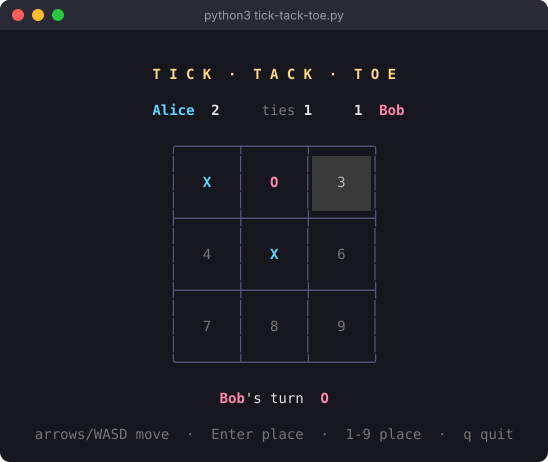
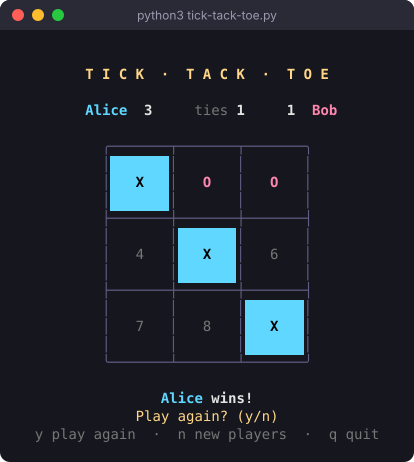

# tick-tack-toe

A two-player tic-tac-toe game for the terminal, written in Python with `curses`.
Move around the board with the arrow keys, keep score across rounds, and watch the
winning line light up.

<p align="center">
  
  
</p>

## Features

- **Arrow-key controls**: move a highlighted cursor around the board and press Enter to place your mark
- **Player names and a running score**: wins and ties are tracked for as long as the same two players keep playing
- **Winning line highlight**: the three winning squares blink, then stay lit in the winner's color
- **Early tie detection**: the round ends as soon as neither player can still make a line, so you don't have to fill the board
- **Alternating starts**: whoever went second last round goes first in the next one
- **Safe input**: taken squares and stray keys are ignored instead of crashing the game

## Requirements

- Python 3
- A terminal at least **56 × 22** characters (the game asks you to resize if it's smaller)
- A 256-color terminal for the full color scheme (8-color terminals get a simpler palette)
- **Windows only:** curses isn't built in, so install it first:

  ```bash
  pip install windows-curses
  ```

## Running the game

```bash
git clone https://github.com/OnweEmmanuel/tick-tack-toe.git
cd tick-tack-toe
python3 tick-tack-toe.py
```

## How to play

1. Enter a name for player **X**, then for player **O**. Press Enter on an empty name to use `Player 1` / `Player 2`.
2. Take turns placing marks. The first player to get three in a row (across, down or diagonally) wins.
3. When the round ends, choose to play again or switch players.

The board squares are numbered like this, and empty squares show their number:

```
1 | 2 | 3
4 | 5 | 6
7 | 8 | 9
```

## Controls

| Key | Action |
| --- | --- |
| `←` `↑` `→` `↓` or `W` `A` `S` `D` | Move the cursor (wraps around the edges) |
| `Enter` or `Space` | Place your mark on the highlighted square |
| `1` – `9` | Place your mark directly on that square |
| `q` or `Esc` | Quit |

When a round ends:

| Key | Action |
| --- | --- |
| `y` | Play again with the same players; the score carries over |
| `n` | New players; the score is wiped and you're asked for names again |
| `q` | Quit |
